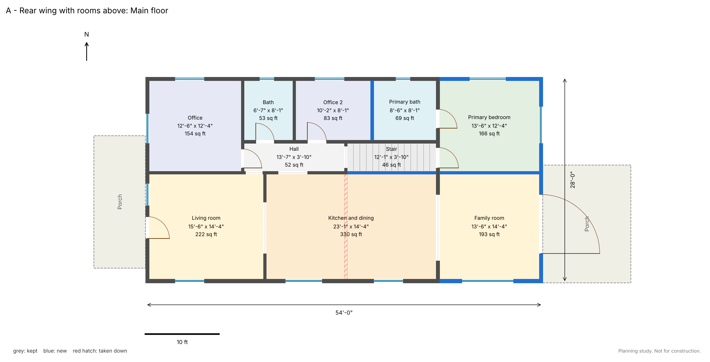
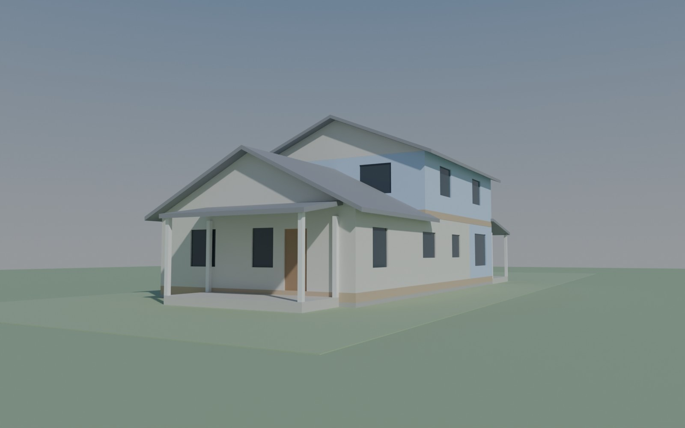
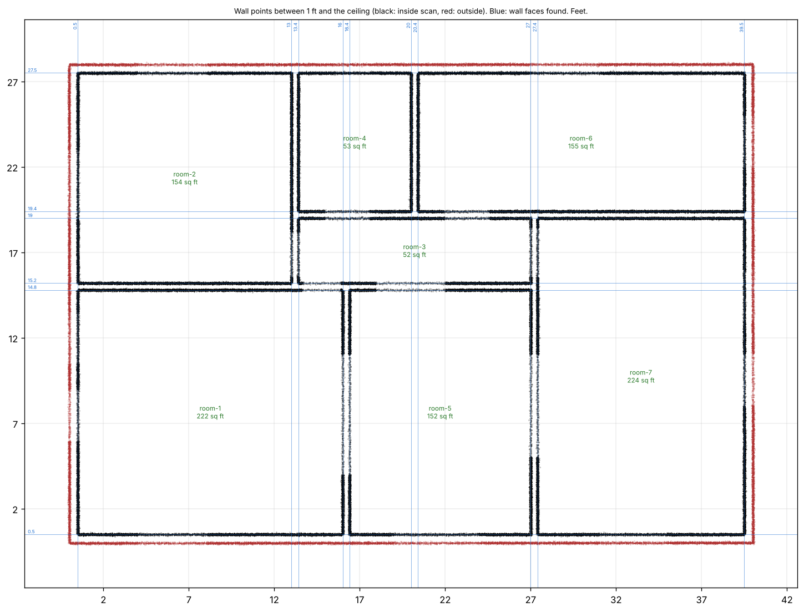
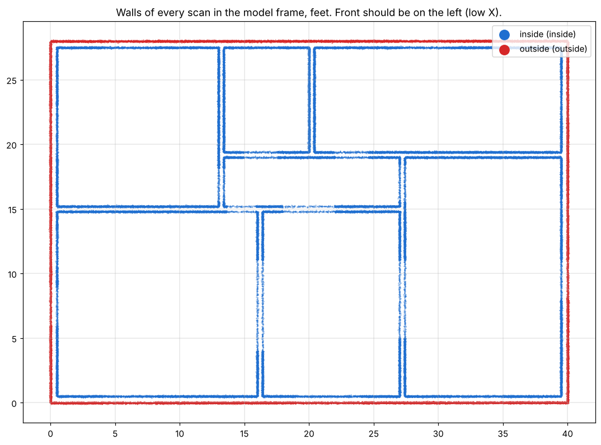

# Scan to remodel

Plan a house remodel with [Claude Code](https://claude.com/claude-code): scan the house with a phone, get a measured floor plan and 3D model, then go round a loop of brief, plan, model and pictures until you are happy with a scheme to take to an architect.

It is a set of Claude Code skills, one per step, on top of a small pipeline of Python scripts. You talk to Claude; Claude runs the scripts, looks at what comes out, and asks you the questions only you can answer.

**What it is for:** the months before you hire an architect, when you are working out what you want, what fits and roughly what it costs. **What it is not:** a design, a survey, a bid, a zoning review or an engineer. Everything it makes is a planning study.

| Plan of a variant: grey kept, blue new, red taken down | Massing render of the same variant |
|---|---|
|  |  |

The pictures on this page are of a made-up sample house in `examples/sample-house/`.

## The workflow

```
phone scan -> point clouds -> existing floor plan and model        once per house
                                      |
                                      v
   grill the brief -> plan a variant -> design model -> render -> review
          ^                                                         |
          +------------------ not yet satisfied -------------------+
                                                                    |
                                                         satisfied: merge to main
```

| Step | Skill | What happens | What you get |
|---|---|---|---|
| Set up | `setup` | Installs `uv`, proves the pipeline on the sample house, starts your project, offers the optional tools | A working clone |
| Scan | `scan-house` | You scan inside and outside with an iPhone LiDAR app (worked out with Modelar). The scans are thinned, squared to the walls and laid over each other | Point clouds in one frame, in feet |
| Existing plan | `existing-plan` | A draft plan is fitted to the scans; Claude and you correct it; it is measured against the scan | `existing/house.json`, floor plan (PNG, DXF), Blender model, IFC |
| Brief | `grill-brief` | Claude interviews you, round by round, until every branch of the brief is settled or knowingly open | `brief.md`, `glossary.md`, `decisions.md` |
| Plan | `plan-variant` | A remodel option as rooms on each floor | Plans showing kept, new and demolished walls; areas; checks; one cost figure |
| Design | `design-model` | The variant in 3D | `house.blend`, `house.glb`, `house.ifc` for Bonsai, FreeCAD or an architect's software |
| Render | `render-pictures` | Cycles renders in a finish set, line drawings, and optional AI pictures held to the model | Street, rear, aerial and cutaway pictures |
| Loop | `remodel-loop` | Review against the brief, decide what to change, go round again; merge when you say it is done | A scheme on `main`, with its record |

## Quick start

You need [uv](https://docs.astral.sh/uv/) and Claude Code. Nothing else: Python and Blender are downloaded by `uv` as libraries.

```bash
git clone https://github.com/wyattjo116/scan-to-remodel
cd scan-to-remodel
uv run pipeline.py --project examples/sample-house run plans model ifc
uv run pipeline.py --project examples/sample-house run render -- a-rear-wing-up --views street --quick
```

Then open Claude Code in the folder and say **"set me up"**. From there: "I've scanned my house", "grill me on the brief", "draw a variant with a rear addition", "what would it look like in white brick", "what next?".

To try the scan steps without a phone:

```bash
uv run pipeline.py --project examples/sample-house run sample-scan      # two made-up scans of the sample house
uv run pipeline.py --project examples/sample-house run scan trace scan-check
```

| Wall points of the made-up scans, with the wall faces found | Inside scan (blue) laid inside the outside scan (red) |
|---|---|
|  |  |

## Your own house: keep it private

Scans, your address, your budget and your family's requirements do not belong in a public repo.

1. Make a **private** copy of this repo (GitHub: "Use this template", or a private fork).
2. In your copy, delete the `/house/` line from `.gitignore`.
3. Copy `templates/house/` to `house/`. Raw scans stay out of git either way.

Only renders, line drawings and style words are ever sent to an outside service, and only in the optional `picture` stage, which you run by hand.

## How a house is described

One JSON file per house state: `existing/house.json` for the house as it stands and `variants/<id>/variant.json` for each option. Each floor is rectangles in feet:

```json
{"id": "kitchen", "label": "Kitchen", "type": "kitchen", "rect": [27.4, 39.5, 0.5, 19.0]}
{"id": "back", "run": "y", "at": 39.75, "span": [8, 11], "height": 6.8, "exterior": true}
```

Whatever is inside the outline and is not a room is wall. Comparing a variant with the existing house gives the kept, new and demolished walls, and from those the cost lines. Plans, the Blender model, the IFC file and the renders are all built from that one file, so they always agree. The format is documented at the top of `scripts/house_geom.py`.

## The stages

```bash
uv run pipeline.py list
```

| Stage | Does |
|---|---|
| `scan` | Raw PLY scans to squared, registered point clouds |
| `trace` | Drafts `existing/house.draft.json` and a plan slice from the scans |
| `scan-check` | Measures `existing/house.json` against the scans |
| `plans` | Floor plans (PNG, DXF), areas, checks, cost |
| `model` | Blender model and glTF |
| `ifc` | IFC4 model |
| `render` | Cycles renders and line drawings |
| `picture` (manual, paid) | AI picture from a render and its line drawing, through OpenAI |
| `drift` (manual) | How far an AI picture drifted from the model |
| `sample-scan` (manual) | Made-up scans of the sample house |

## Optional tools

| Tool | Adds |
|---|---|
| Blender app | Open and edit `house.blend` by hand |
| [Bonsai](https://bonsaibim.org/) | Open `house.ifc` in Blender as a BIM model; cut dimensioned drawings and sheets |
| [FreeCAD](https://www.freecad.org/) | Another way to open the IFC and make drawings |
| OpenAI API key | Photograph-like pictures from renders |
| Unreal Engine | Faster renders from `house.glb` (not scripted here) |

The `setup` skill walks through each.

## Limits

Read these before trusting a number.

- **Rectangles only.** Rooms and outlines are axis-aligned rectangles. Angled walls, curves and bays are drawn as the nearest rectangle.
- **The scan draft is a draft.** It finds plain rooms, doors and windows in a clean scan. Furniture, mirrors and scan drift fool it, it handles one floor at a time, and it cannot see the roof. A person corrects it against the scan slice. Phone LiDAR itself drifts between rooms.
- **Inside and outside scans share no surfaces**, so they are laid over each other to a few inches, not better. Heights are not matched between them.
- **Cost is arithmetic on your rates.** `rates.json` ships with round placeholder numbers. Until you replace them with local figures, the total is only good for comparing variants with each other.
- **Checks are planning checks**: a room with no door, a bedroom with no window, lot coverage against a limit you typed in. They are not building-code or zoning compliance.
- **The models are massing models.** Walls are boxes; there is no structure, no stair design, no door swings.
- **AI pictures drift.** They are illustrations for mood and materials, never a check on a design.
- **Not yet here:** site context (neighbours, trees, sun study), scripted dimensioned sheets from Bonsai or FreeCAD, an Unreal route, multi-floor scan drafting.

## Credits

- The brief interview in `grill-brief` adapts Matt Pocock's [`grilling` and `grill-with-docs` skills](https://github.com/mattpocock/skills) (MIT). See `.claude/skills/grill-brief/CREDITS.md`.
- Built on [Blender](https://www.blender.org/) (as the `bpy` library), [IfcOpenShell](https://ifcopenshell.org/), [Shapely](https://shapely.readthedocs.io/), [ezdxf](https://ezdxf.mozman.at/), NumPy, SciPy and Matplotlib.
- Grew out of a private remodel project; none of that project's data is here.

## Licence

MIT. See [LICENSE](LICENSE).
