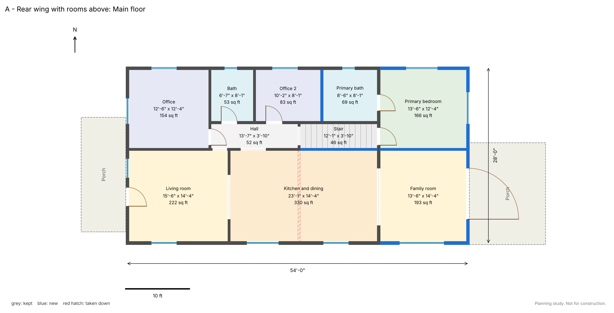
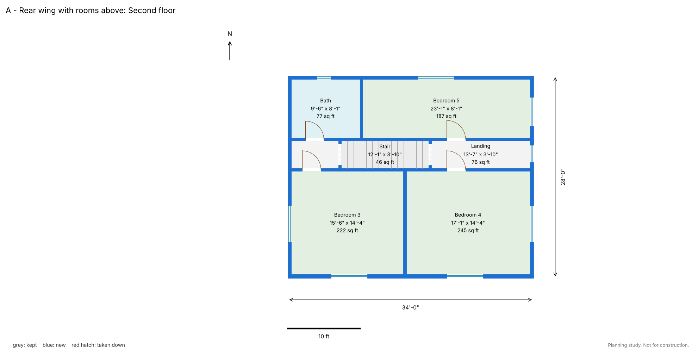

# A - Rear wing with rooms above

The front rooms and the street face stay. The kitchen and dining room become one room. A 14 ft wing at the rear holds a family room and a main-floor bedroom suite, and a second floor over the rear two thirds of the house adds three bedrooms and a bath. The stair goes where the back of the old kitchen was.

**Expected cost: $807,000.** An estimate from `rates.json`, not a bid. 100% of the construction figure rests on guessed rates or guessed items.

This is a planning study. Nothing here has been checked against the zoning code or by an engineer.

## Areas

| Floor | Gross sq ft |
|---|---|
| main | 1,512 |
| upper | 952 |
| **Total floor area** | **2,464** |
| Covered ground (house and porches) | 1,830 |

## Checks

| Where | Check | Result | Detail |
|---|---|---|---|
| main | living at least 11 ft wide | ok | narrow side 14'-4" |
| main | living can be entered | ok | 3 door or opening |
| main | living has a window | ok | 2 windows, 0 glazed doors |
| main | kitchen at least 8 ft wide | ok | narrow side 14'-4" |
| main | kitchen can be entered | ok | 3 door or opening |
| main | kitchen has a window | ok | 2 windows, 0 glazed doors |
| main | family at least 11 ft wide | ok | narrow side 13'-6" |
| main | family can be entered | ok | 2 door or opening |
| main | family has a window | ok | 1 windows, 1 glazed doors |
| main | hall at least 3 ft wide | ok | narrow side 3'-10" |
| main | hall can be entered | ok | 6 door or opening |
| main | stair at least 3 ft wide | ok | narrow side 3'-10" |
| main | stair can be entered | ok | 2 door or opening |
| main | office at least 7 ft wide | ok | narrow side 12'-4" |
| main | office can be entered | ok | 1 door or opening |
| main | office has a window | ok | 2 windows, 0 glazed doors |
| main | bath at least 5 ft wide | ok | narrow side 6'-7" |
| main | bath can be entered | ok | 1 door or opening |
| main | office2 at least 7 ft wide | ok | narrow side 8'-1" |
| main | office2 can be entered | ok | 1 door or opening |
| main | office2 has a window | ok | 1 windows, 0 glazed doors |
| main | bath-primary at least 5 ft wide | ok | narrow side 8'-1" |
| main | bath-primary can be entered | ok | 1 door or opening |
| main | primary at least 8 ft wide | ok | narrow side 12'-4" |
| main | primary can be entered | ok | 2 door or opening |
| main | primary has a window | ok | 2 windows, 0 glazed doors |
| upper | landing at least 3 ft wide | ok | narrow side 3'-10" |
| upper | landing can be entered | ok | 6 door or opening |
| upper | stair-up at least 3 ft wide | ok | narrow side 3'-10" |
| upper | stair-up can be entered | ok | 2 door or opening |
| upper | bed3 at least 8 ft wide | ok | narrow side 14'-4" |
| upper | bed3 can be entered | ok | 1 door or opening |
| upper | bed3 has a window | ok | 2 windows, 0 glazed doors |
| upper | bed4 at least 8 ft wide | ok | narrow side 14'-4" |
| upper | bed4 can be entered | ok | 1 door or opening |
| upper | bed4 has a window | ok | 2 windows, 0 glazed doors |
| upper | bath-up at least 5 ft wide | ok | narrow side 8'-1" |
| upper | bath-up can be entered | ok | 1 door or opening |
| upper | bed5 at least 8 ft wide | ok | narrow side 8'-1" |
| upper | bed5 can be entered | ok | 1 door or opening |
| upper | bed5 has a window | ok | 2 windows, 0 glazed doors |
| all | stair drawn | ok | a stair is needed between floors |
| upper | sits over main | ok | 0 sq ft overhangs the floor below |
| upper | note: share of walls standing on a wall below | ok | 76% |
| lot | lot coverage | ok | 24.4% of the lot against a limit of 45% |
| lot | floor-area ratio | ok | 0.33 against a limit of 0.50 |

## Cost lines

| Line | Quantity | Rate | Amount | Source |
|---|---|---|---|---|
| New ground-floor area (main) | 392 sq ft | $300 | $117,600 | placeholder (guess) |
| Rooms rebuilt inside the existing house (main) | 528 sq ft | $150 | $79,167 | placeholder (guess) |
| Rooms refreshed (main) | 592 sq ft | $40 | $23,689 | placeholder (guess) |
| Walls taken down (main) | 14 ft of wall | $60 | $858 | placeholder (guess) |
| Kitchen fit-out (kitchen) | 1 each | $60,000 | $60,000 | placeholder (guess) |
| Bathroom fit-out (bath-primary) | 1 each | $25,000 | $25,000 | placeholder (guess) |
| New upper-floor area (upper) | 952 sq ft | $250 | $238,000 | placeholder (guess) |
| Bathroom fit-out (bath-up) | 1 each | $25,000 | $25,000 | placeholder (guess) |
| New porch | 192 sq ft | $110 | $21,120 | placeholder (guess) |
| New stair | 1 each | $15,000 | $15,000 | placeholder (guess) |
| Structural work to carry the second floor on the old walls | 1 item | $30,000 | $30,000 | placeholder guess; an engineer sets this (guess) |
| Construction | | | $635,434 | |
| On top: design fees 10%, permits 2%, contingency 15% | | | $171,566 | |
| **Expected cost** | | | **$807,000** | |

## Plans

